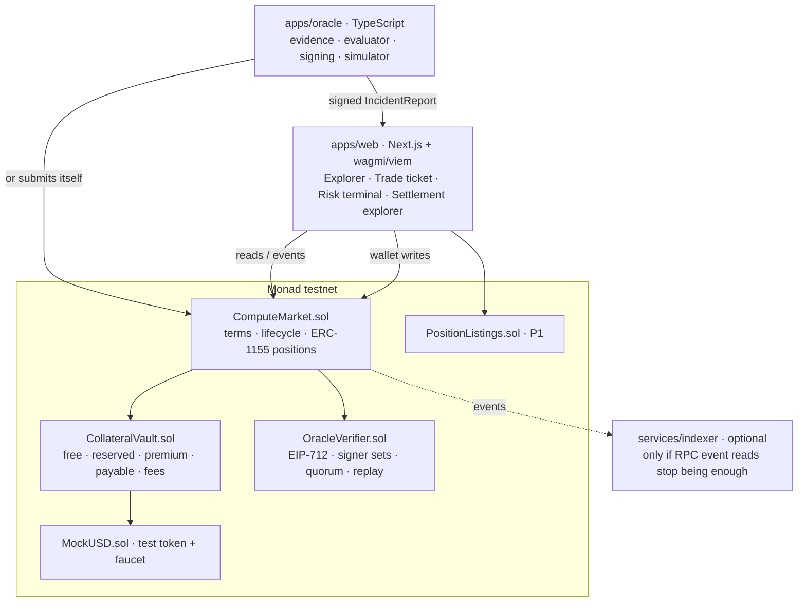

# HYPERHEDGE architecture

Companion to `docs/PRD.md` and `docs/FINANCIAL_MODEL.md` (which defines every rule enforced here). Items marked **[verify D1]** must be checked before building on them.

The design: an onchain settlement core plus a separate market-data and UX layer. **The chain is the source of truth** for money, collateral, claim status and payouts. Any database is a query layer only.

## 1. System map



**Chain:** Monad testnet (10143). **[verify D1]** block time and finality (300ms or 400ms), `block.timestamp` granularity.
**Token:** `MockUSD`, 6 decimals, faucet-rate-limited, labelled "test token, not real USDC". The deploy script refuses mainnet.

## 2. Stack

| Layer | Tech | Responsibility |
|---|---|---|
| Contracts | Solidity 0.8.28, Foundry, OpenZeppelin 5.1 | Financial rules, escrow, claims, settlement |
| Network | Monad testnet | Execution and event logs |
| Web | Next.js 15, TypeScript, wagmi + viem | Terminal, portfolio, claims |
| Oracle | bun + TypeScript, viem (EIP-712 signing) | Evidence collection, evaluation, signer quorum, submission |
| SDK | TypeScript | ABIs, EIP-712 types, lifecycle and payout math mirroring the contracts, chains, gas |
| Indexer | TypeScript + PostgreSQL, **deferred** | Search and analytics. Added only if RPC reads become insufficient. |
| Tests | Foundry (unit, fuzz, invariant), bun e2e | Release gate in PRD §9 |

Tooling rule: bun and TypeScript throughout.

## 3. Contracts

### 3.1 ComputeMarket.sol (orchestrator, ERC-1155 positions)

```solidity
enum State { NONE, OPEN, ACTIVE, REVIEW, DISPUTED, SETTLED, EXPIRED, VOIDED }
enum Outcome { NONE, FAILURE, DELIVERED }

struct Terms {
    address seller;
    bytes32 underlying;     // "H100-80GB-GPUh"
    uint64  quantity;       // GPU-hours covered
    bytes32 slaHash;        // keccak256(canonical SLA JSON); slaURI emitted in event
    uint64  units;          // N
    uint128 payoutPerUnit;  // m
    uint128 premiumPerUnit; // p
    uint16  feeBps;
    uint64  saleEnd;
    uint64  deliveryDeadline;
    uint64  expiry;
    uint32  policyId;
}

struct Status {
    State   state;
    Outcome outcome;
    uint64  sold;
    uint64  challengeEnd;
    uint64  resolveBy;
    bytes32 incidentId;
}

function create(Terms calldata t, string calldata slaURI) external returns (uint256 id); // reserves N*m from free[seller]
function buy(uint256 id, uint64 units, uint128 maxPremium) external;     // slippage guard; mints position
function submitReport(IncidentReport calldata r, bytes[] calldata sigs) external; // verifier check -> REVIEW
function dispute(uint256 id) external;  // seller vs FAILURE (bond from free), holder vs DELIVERED (bond from wallet); locks bond B
function resolve(uint256 id, Outcome o, bool void_) external;           // guardian, before resolveBy
function finalize(uint256 id) external;  // REVIEW past challengeEnd -> SETTLED / EXPIRED; DISPUTED past resolveBy -> VOIDED
function expire(uint256 id) external;    // no report by expiry, or DELIVERED final and past expiry
function claim(uint256 id) external;     // SETTLED: burn units, pay units*m
function refund(uint256 id) external;    // VOIDED: burn units, return units*p
function releaseUnsold(uint256 id) external; // after saleEnd: (N - sold)*m back to free[seller]
```

Events cover every transition, including `Created(id, terms, slaURI)`, `Bought`, `ReportAccepted(id, incidentId, outcome, evidenceHash)`, `Disputed`, `Resolved`, `Settled`, `Expired`, `Voided`, `Claimed` and `Refunded`. Each carries the amounts, so the settlement explorer can rebuild every claim from logs alone.

### 3.2 CollateralVault.sol

```solidity
function deposit(uint256 amount) external;                 // -> free[msg.sender]
function withdraw(uint256 amount) external;                // free only
// onlyMarket:
function reserve(address seller, uint256 id, uint256 amt) external;   // free -> reserved
function release(uint256 id, address seller, uint256 amt) external;   // reserved -> free
function addPremium(uint256 id, address payer, uint256 amt) external; // token in -> premium
function earnPremium(uint256 id, address seller, uint16 feeBps) external; // premium -> free + fees
function toPayable(uint256 id, uint256 amt) external;                 // reserved -> payable
function payOut(uint256 id, address to, uint256 amt) external;        // payable -> token out
function refundPremium(uint256 id, address to, uint256 amt) external; // premium -> token out
function lockBondFromFree(uint256 id, address seller, uint256 amt) external;  // free -> bond (never reserved)
function lockBondFromWallet(uint256 id, address holder, uint256 amt) external; // token in -> bond
function returnBond(uint256 id, address to) external;                  // bond -> disputer
function slashBondToPayable(uint256 id) external;                      // seller's bond -> payable (buyers)
function slashBondToFree(uint256 id, address seller) external;         // holder's bond -> seller free
```

Only `ComputeMarket` can move reserved, premium or payable funds. The conservation invariant from FINANCIAL_MODEL §3 is checked in a Foundry invariant suite and exposed as `reconcile()`, a view the UI can show.

### 3.3 OracleVerifier.sol

```solidity
struct Policy {
    uint8   quorum;
    uint32  challengeWindow;
    uint32  resolveWindow;
    uint16  disputeBondBps;   // of M; demo 1_000 (10%)
    uint128 minBond;          // floor so tiny contracts still carry a real bond
}
function setPolicy(uint32 policyId, Policy calldata p, address[] calldata signers) external; // owner, before use
function revokeSigner(uint32 policyId, address signer) external;                            // owner
function verify(IncidentReport calldata r, bytes[] calldata sigs, uint32 policyId) external returns (bool); // onlyMarket
```

**Rules**
- EIP-712 domain `("HYPERHEDGE", "1", chainId, address(this))`.
- Signers recovered with ECDSA (OpenZeppelin), strictly ascending addresses, ≥ quorum, all active in the policy.
- Marks `incidentId` as used.
- A policy cannot change once a contract references it; new rules mean a new `policyId`.

### 3.4 PositionListings.sol (P1)

```solidity
function list(uint256 id, uint64 units, uint128 pricePerUnit, uint64 expiresAt) external returns (uint256 listingId);
function cancel(uint256 listingId) external;
function fill(uint256 listingId, uint64 units) external; // checks live, unexpired, seller balance + approval; atomic swap
```

- **Enforcement:** every listing and fill is enforced onchain. A listing ID cannot be filled past its units, and a cancelled or expired listing cannot be filled again.
- **No escrow:** positions stay in the holder's wallet until the fill.

### 3.5 MockUSD.sol

Test ERC-20 with `faucet()`, rate-limited per address. It is never presented as a stablecoin.

### 3.6 Privileges

| Role | Can | Cannot |
|---|---|---|
| Owner (deployer in the demo) | Set policies, revoke signers, set the guardian, set the fee treasury | Move user funds, edit terms, settle |
| Guardian | Resolve a DISPUTED contract to an outcome the terms define, or void it, before `resolveBy` | Act outside DISPUTED, or after the deadline |
| Oracle signers | Sign reports | Submit without a quorum, or pay anyone directly |
| Anyone | `submitReport` (with signatures), `finalize`, `expire`, `releaseUnsold` | Anything else on other people's funds |

**Gas:** every write sets an explicit `gas` limit from `packages/sdk/gas.ts`, sized from Foundry gas reports plus a margin, because Monad bills the limit. There are no unbounded loops: claims are pull-based, per holder.

## 4. Oracle service (apps/oracle)

```
evidence/    adapters: simulator (fixture usage reports) · later: provider usage API
evaluator/   SLA JSON + evidence -> FAILURE | DELIVERED, with reasons
signing/     EIP-712 IncidentReport, N demo signer keys (2-of-3 quorum in the demo)
reporting/   submit to ComputeMarket, or hand the signed payload to the web app
simulator/   scripted scenarios: failure, delivered, late report, bad signer, replay
```

**Pipeline**
1. Evidence: a usage report fixture, labelled SIMULATED.
2. The evaluator checks the contract ID, deadline, capacity and SLA.
3. `evidenceHash = keccak256(canonical evidence JSON)`, served at `GET /evidence/:hash` so anyone can check it.
4. Signers sign.
5. Submission.
6. The contract verifies.
7. Settlement is deterministic.

**The demo signers are all run by us.** The UI and README say so. A signature proves who signed, not that the evidence is true.

Signer keys live in a gitignored `.env`. A secret scan runs before every push.

## 5. Web (apps/web)

```
app/
  markets/            explorer: compute class, window, seller, premium, collateral, state; indicative vs executable
  trade/[id]/         trade ticket: terms, evidence policy, approve + buy, receipts
  portfolio/          positions, claimable, refundable, listings (P1)
  risk/               seller collateral, max liabilities, utilization, open claims and disputes, assumptions
  settlements/        incident -> verification -> payout trail, every step linked to the explorer
  faucet/             MockUSD + MON drip for judges
```

- **Trade confirmation:** every one shows the full PRD §7 trust list before signing.
- **Transaction states:** `signing → submitted → included → final`, taken from real receipts, never faked.
- **Data source:** reads and event logs come straight from RPC, from the deployment block. Demo history is small.

## 6. Settlement sequence (failure path)

```mermaid
sequenceDiagram
  participant S as Seller
  participant B as Buyer
  participant W as Web
  participant CM as ComputeMarket
  participant V as Vault
  participant O as Oracle service
  participant OV as Verifier
  S->>V: deposit(1000)
  S->>CM: create(terms) -> reserve 1000
  B->>CM: buy(id, 10, maxPremium) -> premium 100 escrowed, position minted
  Note over O: after deliveryDeadline, evidence evaluated (SIMULATED)
  O->>O: 2-of-3 sign IncidentReport(FAILURE)
  O->>CM: submitReport(report, sigs)
  CM->>OV: verify -> ok, incidentId used
  CM-->>W: ReportAccepted, REVIEW until challengeEnd
  W->>CM: finalize(id) after challengeEnd -> SETTLED
  CM->>V: reserved -> payable 1000; premium -> seller
  B->>CM: claim(id) -> burn 10, pay 1000
```

## 7. Threat model (summary; full doc `docs/THREAT_MODEL.md` later)

| Threat | Control |
|---|---|
| Seller pulls collateral early | Only `free` is withdrawable; reserved moves only through market transitions |
| Forged, replayed or cross-chain report | EIP-712 domain binding, signer set plus quorum, `incidentId` replay guard, `validUntil` |
| Stale report | `validUntil` and `expiry` checks |
| Double claim or refund | Burn-on-claim; zero-before-transfer; terminal states final |
| Oracle outage forcing a payout | Missing data → Expired (no payout) |
| Seller griefs with a dispute | **Dispute bond** (FINANCIAL_MODEL §5a): taken from fresh free balance, slashed to buyers if upheld **or if the guardian misses the deadline**. A frivolous dispute always costs B and never avoids payment while the guardian acts. |
| Guardian abuse | Bounded to outcomes the terms define, and a deadline; MVP trust assumption stated plainly |
| Reentrancy, bad token | `nonReentrant`, SafeERC20, CEI; malicious-token tests |
| Listing replay or oversell | Filled-units tracking, ownership and approval checked at fill, expiry |

Not audited. Never labelled secure or production-ready.

## 8. Testing

**Foundry**
- **Unit:** every row of FINANCIAL_MODEL §6, every state transition, and every privilege in §3.6.
- **Fuzz:** buy amounts, timing around each deadline, signer sets and orderings.
- **Invariant:** a handler drives random deposit/create/buy/report/dispute/resolve/finalize/claim/refund/withdraw. Checked: vault conservation, coverage, no payout above M, terminal states stay terminal.
- **Malicious actors:** a reentrant ERC-20, a false-returning ERC-20, forged and duplicate signatures.

**E2E:** `scripts/run-demo.ts` runs the failure, delivered, frivolous dispute→bond slashed to buyers, guardian timeout→void with slash, and outage→expire scenarios. It runs against anvil and then a clean testnet deployment, prints every tx hash, and reconciles balances.

**Web:** an integration smoke test of the explorer → trade → settlement trail from a fresh wallet.

## 9. Repository layout (target)

```
apps/web/            Next.js terminal
apps/oracle/         evidence, evaluator, signing, reporting, simulator
packages/contracts/  Foundry: src/, test/, script/, foundry.toml
packages/sdk/        abi, eip712, lifecycle + payout math, gas, chains
packages/config/     shared tsconfig, deployment addresses
services/indexer/    deferred
docs/                PRD, ARCHITECTURE, FINANCIAL_MODEL, THREAT_MODEL (later), DEMO_RUNBOOK (later)
scripts/             deploy-testnet.sh, seed-demo.ts, run-demo.ts
.env.example  package.json  README.md
```

**Migration from the current repo:**
1. Tag or branch Pitchside as `pitchside`.
2. Copy over the reusable pieces: Foundry config and OZ pin, gas and chain helpers, ABI generator, Next.js scaffolding and font loading.
3. Remove the Pitchside folders from `main`.

**Needs the owner's OK before anything is deleted.**

## 10. Day-1 verification checklist

1. Monad testnet block time, finality and timestamp granularity.
2. wagmi connectors for Monad testnet (MetaMask), plus a judge-friendly fallback with no private key published.
3. Testnet RPC limits under terminal polling.
4. Gas for `submitReport` with 3 signatures, and for `create` and `buy`.
5. Competitor sweep: Metropolis projects in compute markets and SLA insurance.
