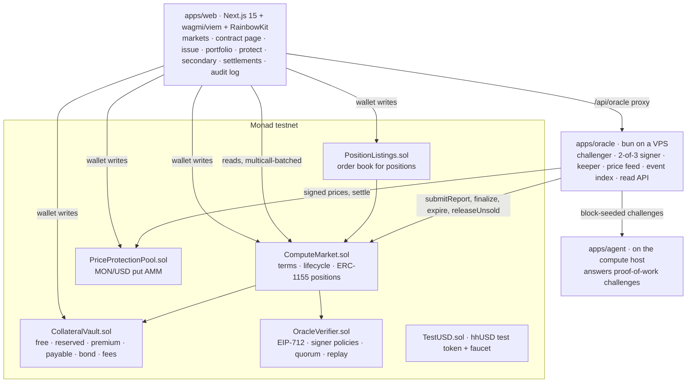
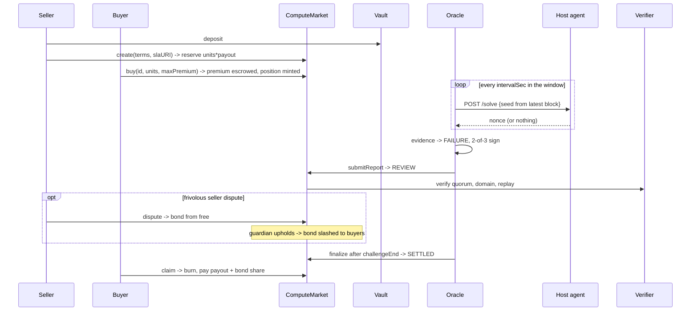

# HYPERHEDGE architecture

As built and deployed on Monad testnet (chain 10143). Companion to `docs/PRD.md` and `docs/FINANCIAL_MODEL.md`, which defines every rule enforced here.

**The chain is the source of truth** for money, collateral, claim status and payouts. The oracle's state and its event index are query layers only.

## 1. System map



- **Chain:** Monad testnet, chain id 10143, with 300 ms blocks since MIP-12.
- **Token:** `TestUSD` ("HYPERHEDGE Test USD", `hhUSD`), 6 decimals.
  - `faucet()` gives 1,000 per call with a 1-hour cooldown per address.
  - The deploy script refuses mainnet (`test_refusesMainnet`).

## 2. Stack

| Layer | Tech | Responsibility |
|---|---|---|
| Contracts | Solidity 0.8.28, Foundry, OpenZeppelin 5.1 | Financial rules, escrow, claims, settlement, listings, price pool |
| Agent | bun | Answers `POST /solve` with a proof of work, one at a time |
| Oracle | bun + viem | Challenges, evidence, 2-of-3 EIP-712 reports, keeper transitions, MON/USD price reports, event index, HTTP API |
| SDK | TypeScript | ABIs, EIP-712 types, SLA commitment, proof-of-work, evidence builder and independent verifier |
| Web | Next.js 15, wagmi 2, viem, RainbowKit, motion, CSS modules | Trading terminal and landing page |

## 3. Contracts

### 3.1 ComputeMarket.sol (orchestrator, ERC-1155 positions; token id = contract id)

```solidity
enum State { NONE, OPEN, ACTIVE, REVIEW, DISPUTED, DELIVERED, SETTLED, EXPIRED, VOIDED }
enum Outcome { NONE, FAILURE, DELIVERED }

function create(Terms calldata t, string calldata slaURI) external returns (uint256 id); // reserves units*payout from free[seller]
function buy(uint256 id, uint64 units, uint256 maxPremium) external;     // slippage guard; premium escrowed; position minted
function releaseUnsold(uint256 id) external;                             // after saleEnd: unsold collateral back to free
function submitReport(IncidentReport calldata r, bytes[] calldata sigs) external; // quorum-verified -> REVIEW
function dispute(uint256 id) external;   // seller vs FAILURE (bond from free), holder vs DELIVERED (bond from wallet)
function resolve(uint256 id, Outcome o, bool void_) external;            // guardian, before resolveBy
function finalize(uint256 id) external;  // REVIEW past challengeEnd -> SETTLED / DELIVERED / EXPIRED; DISPUTED past resolveBy -> VOIDED + slash
function expire(uint256 id) external;    // no report by expiry, or DELIVERED and expiry reached
function claim(uint256 id) external;     // SETTLED: burn units, pay units*(payout + bond share)
function refund(uint256 id) external;    // VOIDED: burn units, return units*(premium + bond share)
```

- **SLA commitment:** `slaHash` is `keccak256` of the canonical SLA JSON. `slaURI` is an inline `data:` URI carrying that exact JSON, so the terms a buyer reads are the terms the oracle evaluates.
- **The SLA itself:** host URL, difficulty bits, required solves, challenge interval, answer deadline and compute class.
- **DELIVERED is a holding state:** delivery is final, and funds release at expiry.

### 3.2 CollateralVault.sol

```solidity
function deposit(uint256 amount) external;                 // -> free[msg.sender]
function withdraw(uint256 amount) external;                // free only
// onlyMarket:
reserve · release · pullPremium · earnPremium · refundPremium · makePayable · payOut
lockBondFromFree · lockBondFromWallet · returnBond · returnBondToFree · slashBondToPayable · slashBondToFree
function reconcile() external view returns (bool ok, uint256 balance, uint256 tracked);
```

- **Who moves locked funds:** only `ComputeMarket` can move reserved, premium, payable or bond funds.
- **No mixing:** a seller's dispute bond always comes from fresh free balance, never from the reserved collateral.
- **`reconcile()`:** proves onchain that the token balance equals the sum of every bucket. The demo scripts call it after every run.

### 3.3 OracleVerifier.sol

```solidity
struct Policy { uint8 quorum; uint32 challengeWindow; uint32 resolveWindow; uint16 disputeBondBps; uint128 minBond; }
function createPolicy(uint32 policyId, Policy calldata p, address[] calldata signers) external; // owner
function revokeSigner(uint32 policyId, address signer) external;                               // owner
function verify(IncidentReport calldata r, bytes[] calldata sigs, uint32 policyId) external;  // onlyMarket
```

- **Domain:** the EIP-712 domain is bound to the chain id and this contract.
- **Signatures:** signers are recovered with ECDSA and must come in strictly ascending address order, reach the quorum, and all be active.
- **Replay:** `incidentId` is marked used.
- **Live policy 1:** 2 of 3 signers, a 5-minute challenge window, a 30-minute resolve window, and a bond of 10% of M with a minimum of 10 hhUSD.

### 3.4 PositionListings.sol

```solidity
function list(uint256 id, uint128 units, uint128 pricePerUnit, uint64 expiresAt) external returns (uint256 listingId);
function cancel(uint256 listingId) external;
function fill(uint256 listingId, uint128 units) external; // atomic: payment to seller, position to buyer
```

- **No escrow:** positions stay in the holder's wallet until a fill.
- **At fill time:** ownership and `setApprovalForAll` are checked, so a stale listing fails.
- **Claim rights:** they move with the position (`test_claimRightMovesWithFill`).

### 3.5 PriceProtectionPool.sol

An LP-backed AMM that sells protection against MON falling against USD.

- **LPs:** deposit hhUSD for shares. Collateral locked against open positions cannot be withdrawn.
- **Buyers:**
  - choose notional, strike (70-99% of spot) and duration (1 h, 6 h or 24 h);
  - pay a premium from `quote()`: vol × √t minus half the out-of-the-money distance, floored, then scaled up with pool utilization;
  - must buy with a quorum-signed price at most 2 minutes old.
- **Settlement:** anyone settles with a quorum-signed price published inside `[expiry, expiry + 10 min]`. The payout is capped at max payout.
- **No price reported:** after 1 day the position lapses and pays nothing.

### 3.6 Privileges

| Role | Can | Cannot |
|---|---|---|
| Owner (deployer in the demo) | Create policies, revoke signers, set the guardian, set pool vol and signers, withdraw protocol fees | Move user funds, edit terms, settle |
| Guardian | Resolve a DISPUTED contract to a defined outcome, or void it, before `resolveBy` | Act outside DISPUTED, or after the deadline |
| Oracle signers | Sign reports and prices | Submit without a quorum, or pay anyone directly |
| Anyone | `submitReport` / `settle` (with signatures), `finalize`, `expire`, `releaseUnsold`, `lapse` | Anything else on other people's funds |

**Gas:** Monad bills the gas *limit*, so every write estimates gas and adds a 20-30% margin instead of using a blanket ceiling. Claims are pull-based, per holder, and there are no unbounded loops onchain.

## 4. Delivery proof: agent + oracle

1. **Seed:** during `[saleEnd, deliveryDeadline]`, at every `intervalSec` the oracle takes the latest block and derives `seed = deriveSeed(contractId, index, blockHash)`. The seed cannot exist before that block.
2. **Challenge:** the oracle posts the seed to the SLA host.
3. **Proof:** the agent finds a nonce where `sha256(seed ‖ nonce)` has *d* leading zero bits. That is about 2^*d* hashes of work, and checking it takes one.
4. **Late answers:** an answer after `answerWithinSec`, a wrong answer or no answer counts as missed.
5. **Fairness:** only one challenge per host is in flight at a time, so two contracts on one host never make an honest host look slow.
6. **Report:** after the deadline, the evidence file (every challenge, block, seed, nonce and timestamp) is canonicalised, hashed and stored at `GET /evidence/:hash`. Then two signers sign the `IncidentReport` and the oracle submits it.
7. **Abstain:** if the oracle itself issued fewer challenges than the window allows (minus one), it does not report. The contract then expires, and missing data never pays out.
8. **Re-checkable:** anyone can re-run `verifyEvidence` in the browser (the **Verify the evidence yourself** button). It re-derives every seed, checks every proof, compares every block hash with the chain and recounts the verdict.

**Keeper:** the oracle also sends every permissionless transition (`releaseUnsold`, `finalize`, `expire`, pool `settle`) so funds never wait on a person.

**Event index:** market, vault, pool and listings logs are scanned in 100-block chunks (the public RPC's `eth_getLogs` cap) and served at `/events`. This powers the activity log, the settlements list and liquidity history.

**HTTP API:** `/health`, `/contracts`, `/contracts/:id`, `/evidence/:hash`, `/events`, `/price/latest`, `/price/at/:ts`, `/price/history`, `/price/candles`.

**Signer operation:** one operator runs all three signers in the demo. The quorum is enforced onchain; independent operators are the next step. Signer keys live in a gitignored `.env`.

## 5. Web (apps/web)

- **Routes:** `/` is the landing page and `/app` the dashboard.
  - **Trade:** markets, contract detail `/app/c/[id]` (proof tape, trust panel, buy, dispute, claim, refund, evidence verify), issue, protect (price pool), secondary (listings).
  - **Manage:** portfolio, providers, simulator.
  - **Verify:** evidence, settlements, activity.
  - **Protocol:** liquidity (vault buckets + `reconcile()`), risk, analytics.
  - **Other:** developers, faucet, status, settings.
- **Reads:**
  - viem with Multicall3 batching;
  - a fallback transport across several public Monad RPCs, or a dedicated key via `NEXT_PUBLIC_RPC_URL`;
  - polls that pause while the tab is hidden.
- **Oracle data:** comes through the `/api/oracle/*` rewrite to the VPS.
- **Numbers:** no number on screen is invented. Each one comes from the chain, from the oracle, or is labelled as user input.

## 6. Settlement sequence (failure path, as run live)



## 7. Threat model (summary)

| Threat | Control |
|---|---|
| Seller pulls collateral early | Only `free` is withdrawable; reserved moves only through market transitions |
| Forged, replayed or cross-chain report | EIP-712 domain binding, signer set plus quorum, `incidentId` replay guard, `validUntil` |
| Precomputed proofs | Seeds derive from a fresh block hash; the verifier checks each block hash against the chain |
| Stale report or price | `validUntil`, `expiry`, `MAX_PRICE_AGE`, `SETTLE_WINDOW` |
| Double claim or refund | Burn-on-claim; terminal states are final |
| Oracle outage forcing a payout | The oracle abstains; no report by expiry means the contract expires with no payout |
| Seller griefs with a dispute | Bond from fresh free balance, slashed to buyers if the report stands **or the guardian misses the deadline** |
| Guardian abuse | Bounded to defined outcomes and a deadline; a stated trust assumption |
| Listing replay or oversell | Filled-units tracking, ownership and approval checked at fill, expiry |

Not audited. Testnet only.

## 8. Testing

- **Foundry, 69 tests:**
  - unit tests for every rule in FINANCIAL_MODEL;
  - fuzz tests (`testFuzz_settlementConserves`, `testFuzz_solvency`);
  - invariants (`invariant_vaultReconciles`, `invariant_collateralCoversLiabilities`) over random action sequences;
  - malicious tokens (`MaliciousToken.t.sol`): false-returning, no-return, reentrant on deposit and withdraw, and fee-on-transfer (detected by `reconcile()`, not supported).
- **SDK, 8 tests:** proof-of-work, SLA commitment, evidence recount and tamper detection.
- **Live end-to-end on Monad testnet:**
  - `apps/oracle/scripts/run-demo.ts` runs the delivered and failure paths.
  - `apps/oracle/scripts/run-dispute.ts` runs three fresh wallets, a frivolous dispute, the bond slashed to buyers, and claims.
  - Both print every tx and call `reconcile()`. Logs are in `docs/runs/`.
- **Release gate:** the evidence for each item is mapped in `docs/RELEASE_GATE.md`.

## 9. Repository layout

```
packages/contracts   Foundry: src/, test/ (unit, fuzz, invariant), script/Deploy.s.sol, script/DeployPool.s.sol
packages/sdk         ABIs, EIP-712 types, SLA, proof-of-work, evidence + verifier, chains, deployment
apps/agent           proof-of-work responder for the compute host
apps/oracle          challenger, signer, keeper, price oracle, event index, API; scripts/run-demo.ts, run-dispute.ts
apps/web             Next.js terminal and landing page
deployments          addresses per chain
docs                 PRD, ARCHITECTURE, FINANCIAL_MODEL, RELEASE_GATE, runs/, logo
scripts              gen-abi.ts
```
