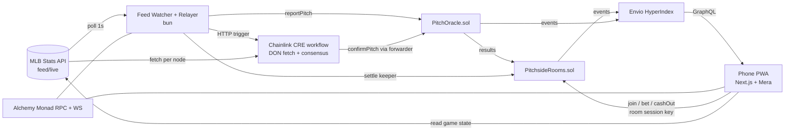
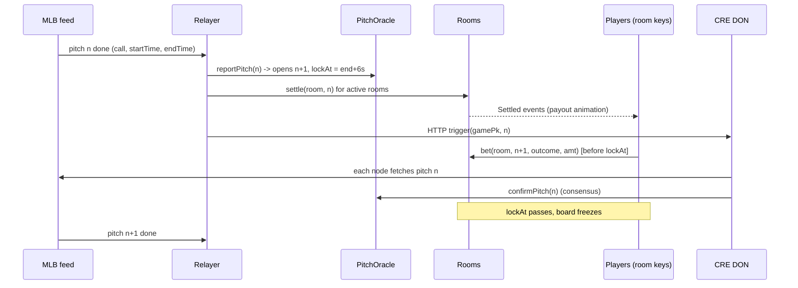

# Pitchside architecture

Companion to `docs/PRD.md`. Items marked **[verify D1]** are unconfirmed and must be checked on day 1 before building on them.

## 0. Decisions made while building (v1.1, 9 Oct 2026)

These supersede the matching lines further down.

| # | Was | Now | Why |
|---|---|---|---|
| 1 | `LOCK_DELAY = 6s` | **8s**, constructor parameter | With feed latency plus inclusion (~2-3s), 6s left about 3s to tap. 8s stays under the measured p1 gap (8.7s). In the real game under 2% of next pitches start inside it, and those late bets are refunded on chain. |
| 2 | Stakes winnings held in `pendingChips` until CRE confirms | **Stakes markets settle only after confirmation** | Removes the pending-balance state entirely. The board shows the fast result as provisional ("Waiting on Chainlink"). |
| 3 | No escape if a result never arrives | **`STALE_AFTER = 1h`** after lock, anyone can settle and refund. **`closeGame`** voids the dangling market after the final out | Funds can never be stuck in a pot. |
| 4 | Replace-bet could push the bettor twice | Bettor is pushed only on the first bet of a market | Otherwise `settle` would pay twice. Tested. |
| 5 | Refund comparison granularity unknown | Oracle floors `startTs` to seconds | Conservative: a bet landing in the same second the pitch began counts as late. |
| 6 | CRE confirms by seq | CRE trigger carries `playId`. Each node finds the pitch itself and votes VOID if the relayer's seq does not match | The DON checks the relayer instead of trusting it. The cron sweep confirms by position as the backstop. |
| 7 | CRE fetches the full feed (~790KB) | `?fields=` filter, ~95KB, all pitches intact | Keeps each node's HTTP response small. |
| 8 | Player list from Envio | **`members(roomId)` on chain** (max 32) | The core UI works without an indexer or huge `getLogs` ranges (Monad makes ~288k blocks a day). |
| 9 | One drip per passkey per day | Up to 4 per account per day, one per target address, global daily cap | A host needs gas for both the main account (createRoom) and the room key. |
| 10 | First market locked at the scheduled start | Locks at `max(scheduled, now + 30s)` | A late start no longer leaves pitch #1 with no window. |
| 11 | Mera package unknown | `@category-labs/mera` 0.2.0 (`createPasskeyWithPrfOutput`, `getPasskeyPrfOutput`, `createSecp256k1SigningSession`, `toViemAccount`) | From the Monad docs. |

**Open product question:** the PRD's 4% rake is charged on every pitch. In the full replay, random players lost about 60% of Stakes buy-ins to rake in one game, because stacks churn roughly 25x per game. The $24/game unit economics assumed flat $1 bets and hide this. Consider 1%, or rake on net winnings per game.

## 1. System overview



**Chain:** Monad testnet (10143) for build and demo; the same deployment works on mainnet (143).
**Stake token:** AUSD (Stakes mode) **[verify D1: AUSD address on testnet]**. Points mode needs no token.

## 2. Components

| Component | Tech | Responsibility |
|---|---|---|
| `PitchOracle.sol` | Solidity 0.8.x, Foundry | Stores pitch results per (gamePk, seq), lock times, relayer and CRE confirmations, void flags |
| `PitchsideRooms.sol` | Solidity | Rooms, chip balances, bets, parimutuel settlement, rake, cash-out |
| Feed Watcher + Relayer | bun, TypeScript, viem | Polls MLB `feed/live`, diffs pitches, posts reports, drips MON, runs the settle keeper, triggers CRE |
| CRE workflow | Chainlink CRE TypeScript SDK **[verify D1: TS SDK + HTTP trigger + EVM write on Monad]** | Independently fetches the pitch on each DON node, reaches consensus, writes `confirmPitch` |
| Web app | Next.js (App Router), bun, viem, `mera` | Join, board, bets, standings, cash-out. Mobile-first PWA |
| Indexer | Envio HyperIndex | Standings, streaks, room feed, latency stats via GraphQL |
| RPC | Alchemy Monad RPC + WebSocket | Reads, event subscriptions, transaction submission |

## 3. Keys and accounts (Mera)

```
passkey (Face ID)
  └─ PRF (32 bytes, fixed salt, rpId = pitchside.app)
       └─ BIP-39 → BIP-32  m/44'/60'/0'/0/i
            ├─ i = 0          main account   (holds AUSD; signs buy-in and sweep, one Face ID each)
            └─ i = roomId     chip-stack key (holds buy-in + MON drip; signs bets silently)
```

- Room keys use Mera's **hold session** (`createSecp256k1SigningSession`, `toViemAccount`). Main account uses the per-transaction pattern.
- `session.end()` runs on cash-out, room leave and `visibilitychange: hidden` after 10 min.
- **Blast radius:** a leaked room key loses at most that room's buy-in.
- rpId is fixed forever (domain change = lost accounts); export the mnemonic from settings.

## 4. Contracts

### 4.1 PitchOracle

```solidity
enum Outcome { NONE, BALL, STRIKE, FOUL, IN_PLAY, VOID }

struct Pitch {
    uint64  startTs;     // pitch start, unix seconds (floor)
    uint64  endTs;       // pitch end
    uint64  lockAt;      // betting close for the NEXT pitch = endTs + LOCK_DELAY
    Outcome fast;        // relayer report
    Outcome confirmed;   // CRE report
}

mapping(uint32 gamePk => mapping(uint16 seq => Pitch)) public pitches;
mapping(uint32 gamePk => uint16) public lastSeq;
uint64 public immutable lockDelay; // 8 in deployments, see section 0

function openGame(uint32 gamePk, uint64 firstLockAt) external onlyRelayer;
function reportPitch(uint32 gamePk, uint16 seq, Outcome o, uint64 startTs, uint64 endTs) external onlyRelayer;
function confirmPitch(uint32 gamePk, uint16 seq, Outcome o) external onlyCreForwarder; // mismatch => VOID
function lockAt(uint32 gamePk, uint16 seq) external view returns (uint64); // = pitches[seq-1].lockAt
function finalOutcome(uint32 gamePk, uint16 seq, bool requireConfirm) external view returns (Outcome);

event PitchReported(uint32 indexed gamePk, uint16 indexed seq, Outcome o, uint64 startTs, uint64 endTs, uint64 nextLockAt);
event PitchConfirmed(uint32 indexed gamePk, uint16 indexed seq, Outcome o, bool matched);
```

**Rules**
- `reportPitch` requires `seq == lastSeq + 1`, which keeps ordering strict.
- Missing pitches in the feed (e.g. a pickoff, no pitch) do not consume a seq. Seq counts pitches only (`isPitch == true`).
- Between half-innings or during pitching changes, `lockAt` is still `endTs + 6`. The board then shows "locked, waiting for next pitch", which is honest.

### 4.2 PitchsideRooms

```solidity
enum Mode { POINTS, STAKES }

struct Room {
    address host;
    Mode    mode;
    uint16  rakeBps;      // 0 for POINTS, 400 for STAKES
    uint32  gamePk;       // current game session
    uint8   players;      // <= 32
}

struct Bet { uint96 amount; Outcome o; uint64 ts; }          // one slot

mapping(uint256 => Room) public rooms;
mapping(uint256 => mapping(address => uint256)) public chips;           // room => player => balance
mapping(uint256 => mapping(uint32 => mapping(uint16 => address[]))) bettors; // room/game/seq
mapping(uint256 => mapping(uint32 => mapping(uint16 => mapping(address => Bet)))) bets;
mapping(uint256 => mapping(uint32 => mapping(uint16 => uint256[6]))) pot;  // per outcome
mapping(uint256 => mapping(uint32 => mapping(uint16 => bool))) settled;

function createRoom(Mode mode) external returns (uint256 roomId);
function setGame(uint256 roomId, uint32 gamePk) external;           // host only
function join(uint256 roomId, uint256 buyIn) external;              // POINTS: mints 1000 chips once per game
function bet(uint256 roomId, uint16 seq, Outcome o, uint96 amount) external;
function settle(uint256 roomId, uint16 seq) external;               // anyone (keeper)
function cashOut(uint256 roomId) external;                          // STAKES: only confirmed winnings withdrawable
```

**`bet` checks**
- `block.timestamp < oracle.lockAt(gamePk, seq)`
- `amount <= chips/4`
- player is in the room
- outcome in `BALL..IN_PLAY`
- Re-betting replaces the old bet: refund the old amount, then apply the new one.

**`settle`**
- Reads `finalOutcome` (Points: fast; Stakes: confirmed).
- Every bet with `ts >= startTs` is refunded.
- `VOID`, or no winning bets, or only one outcome used: refund all.
- Otherwise: `payout_i = bet_i * (pot_total - rake) / pot_winning`. Integer math; dust goes to rake.
- Loop is bounded by 32 players.

**Stakes withdrawals**
- Chips from fast-settled but unconfirmed pitches stay in `pendingChips`.
- `cashOut` releases confirmed amounts only.
- CRE confirmation calls back `settleConfirmed` through the keeper.

**Gas (Monad charges the gas limit)**
- Every transaction sets an explicit `gas`.
- `bet` is about 1 cold SLOAD + 3 SSTORE.
- Storage is packed into `Bet` (single slot).

## 5. Per-pitch sequence



**Latency budget, pitch end → payout on screen:**

| Step | Time |
|---|---|
| Feed update | ~1 to 3s **[measure D1]** |
| Watcher poll | ≤ 1s |
| `reportPitch` + `settle` included | ~0.3 to 0.6s |
| WS event to UI | ~0.2s |
| **Target** | **< 5s**, inside the 6s window |

## 6. Feed watcher (bun)

- Poll `GET https://statsapi.mlb.com/api/v1.1/game/{gamePk}/feed/live` every 1s, or use `/feed/live/diffPatch?startTimecode=` to cut payload **[verify D1]**.
- Flatten `liveData.plays.allPlays[].playEvents[]` where `isPitch`. Seq = running index.
- Map `details.call.description` to an Outcome (table in PRD §8). Unmapped means VOID.
- Track `lastPostedSeq` in memory and on disk (`state.json`) to survive restarts.
- Nonce manager: one relayer EOA, sequential nonces, explicit gas, resend on drop.
- **Drip:** on `/drip` (signed by the main account address, 1 per passkey per day) send 0.05 MON **[tune D1]** to the room key.
- **Keeper:** after each report, `settle(roomId, seq)` for rooms with bets on that seq (read from Envio or local event cache).

## 7. CRE workflow

```
trigger:  HTTP (from relayer: { gamePk, seq })   [fallback: cron sweep of unconfirmed pitches]
step 1:   HTTP GET feed/live on every DON node
step 2:   extract pitch seq → outcome (same mapping code, shared package)
step 3:   consensus (identical outcome across nodes)
step 4:   EVM write → PitchOracle.confirmPitch(gamePk, seq, outcome) via Chainlink forwarder
```

**[verify D1]** CRE support for Monad testnet as a write target, HTTP trigger availability, end-to-end latency.

If CRE can't write to Monad in time: run the CRE workflow in simulation (`cre workflow simulate`) against live pitches. Then post its signed report through the relayer, with the source labelled "CRE-simulated" onchain and in the README. Never present it as live DON confirmation.

## 8. Web app

```
app/
  r/[roomId]/page.tsx     board: strike zone, countdown ring, outcome pads, pot, feed
  r/[roomId]/join         Face ID, buy-in picker
  new/page.tsx            create room, pick game (schedule from statsapi)
lib/mera.ts               derive main + room keys, sessions
lib/contracts.ts          viem clients, ABIs, explicit gas
lib/mlb.ts                game state for UI (count, batter, pitch coords)
lib/indexer.ts            Envio GraphQL queries
```

- **State:** UI game state comes from MLB directly; money state only from chain events and Envio.
- **Optimistic UI:** a bet shows as "sent" immediately, then confirms on the receipt (~0.3s).

## 9. Indexer (Envio HyperIndex)

**Entities**
- `Room`
- `Player { room, address, chips, streak, bestStreak, wins }`
- `Bet`
- `PitchMarket { pot by outcome, outcome, settledAt, latencyMs }`
- `GameSession`

**Derived**
- Season standings per room.
- Room feed ("Dani called 4 strikes in a row").
- Settlement latency p50/p95 for the README.

## 10. Security and integrity

| Threat | Control |
|---|---|
| Bet after seeing the pitch (courtsiding, feed lag) | `lockAt = prevEnd + 6s`; refund if `ts >= startTs`; data says next pitch ≥ 8.7s later 99% of the time |
| Lying or broken relayer | CRE confirmation; mismatch → VOID + refund; Stakes withdrawals wait for confirmation |
| Room key theft | Holds only the buy-in; session ends on cash-out; main key never held in a session |
| Drip abuse | 1 drip per passkey-derived main address per day; capped total per day |
| Rounding/dust | Integer math, dust to rake, invariant test: sum(chips) + rake == deposits |
| Host griefing (changing game mid-session) | `setGame` only allowed when the room has no unsettled bets |
| Unbounded loops | 32 players max per room |

Not audited. Never label it secure or production-ready.

## 11. Testing

**Foundry unit tests**
- lock boundary
- refund-after-start
- VOID paths
- one-sided pots
- rake math
- replace-bet
- cash-out with pending vs confirmed

**Invariant test:** chip conservation.

**Replay test:** feed watcher against a saved finished game (`g.json`, gamePk 849834, 294 pitches) at 10x speed on a local anvil. Checks every seq posts in order and outcomes match the mapping. This is a real recorded game, not invented data.

**Live tests**
- ALDS G5 (Oct 10) with relayer only.
- NLCS G1 (Oct 11) with real players.

## 12. Repo layout

```
contracts/            Foundry: src/PitchOracle.sol, src/PitchsideRooms.sol, src/mocks/MockAUSD.sol,
                      test/ (unit, fuzz, invariant), script/Deploy.s.sol
sdk/      outcome, mapping, feed, confirm (CRE logic), payout, drip, chains, gas, abi/
backend/relayer/         src/: feed-source, oracle-reporter, settle-keeper, cre-trigger, drip-server, state
                      scripts/: replay.ts (real game, local chain), dev-local.ts (local app stack)
backend/cre/    src/main.ts (HTTP trigger + cron sweep), config.staging.json
backend/indexer/         config.yaml, schema.graphql, src/EventHandlers.ts (Envio)
frontend/             Next.js: app/ (home, new, r/[roomId], api/region), components/, hooks/, lib/
fixtures/mlb/         feed-849834-final.json (real finished game, trimmed)
deployments/          <chainId>.json written after deploy
docs/                 PRD.md, ARCHITECTURE.md
```

**Secrets** (relayer key, Alchemy key) go in `.env`, which is gitignored. Run a secret scan before any push. `ideas/` stays out of the public repo.

## 13. Day-1 verification checklist

1. AUSD address on Monad testnet (or decide mainnet $1-5 stakes / Points-only).
2. Mera hold-session API names and RN/web behavior on target phones.
3. CRE: TS SDK, HTTP trigger, Monad write support, latency.
4. MLB feed update latency after a pitch (measure live on ALDS G5).
5. Monad `block.timestamp` granularity at 300ms blocks (seconds vs ms). Adjust the refund comparison if it is ms.
6. Envio HyperIndex Monad testnet support.
